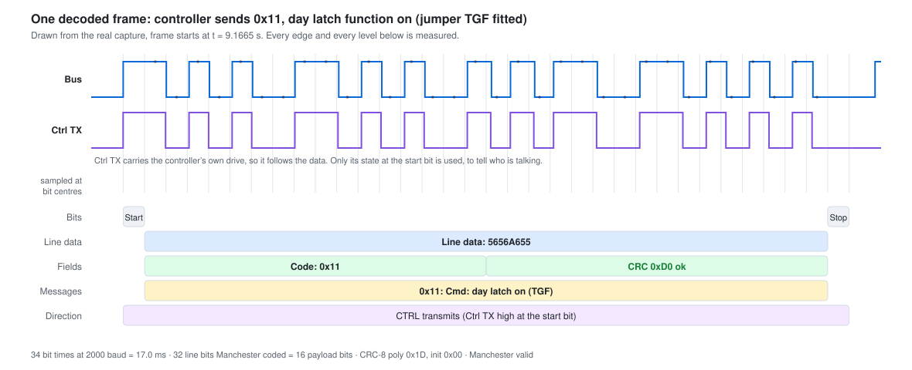

# sigrok-fuhr-multitronic

A [sigrok / PulseView](https://sigrok.org) protocol decoder for the serial bus
between a **Fuhr multitronic** electronic multi-point lock (and white-label locks such as the HMB Motortronic) and its controller.

The protocol is not published by the manufacturer. It was reverse engineered
from 30 logic-analyser captures of a working installation; this decoder turns
the raw hex on the wire into message names, direction and a CRC check.



*The controller sending `0x11` — day latch function on, jumper TGF fitted.
Drawn from a real capture, so every edge, level and timing above is measured.*

---

## Install

Copy the `fuhr_multitronic` directory into your libsigrokdecode decoders
directory:

| Platform | Path |
|---|---|
| Windows | `C:\Program Files\sigrok\PulseView\share\libsigrokdecode\decoders\fuhr_multitronic` |
| Linux | `/usr/share/libsigrokdecode/decoders/fuhr_multitronic` |
| Any | any directory pointed at by the `SIGROKDECODE_DIR` environment variable |

Restart PulseView. The decoder appears as **Fuhr multitronic** under
*Embedded/industrial*.

## Channels

| Channel | Required | Description |
|---|---|---|
| **Bus** | yes | the bus line, carries all traffic |
| **Ctrl TX** | no | the line the controller drives while it transmits |

The **Ctrl TX** line is worth wiring up but is not essential. It carries the
controller's own drive signal, so it follows the data rather than sitting at a
steady level for the frame; the decoder only samples it at the start bit, which
is enough to label who is talking. Without it, direction is recovered from the
message code instead — every code is only ever sent by one of the two parties.
Both paths are covered by the test suite.

## Options

| Option | Default | Notes |
|---|---|---|
| Bit rate | `2000` | baud |
| Bus polarity | `idle-low` | matches the captures; the start bit is a physical high |
| Manchester mapping | `10=1` | flip to `01=1` if a future capture disagrees |
| Annotate individual line bits | `no` | turn on to inspect the raw Manchester pairs |

## Annotation rows

* **Bits** — start bit, stop bit, optionally each line bit
* **Line data** — the raw 32 line bits as hex, i.e. what you saw before
* **Fields** — message code and CRC, with the CRC marked ok or bad
* **Messages** — the decoded message name
* **Direction** — `CTRL transmits` / `LOCK transmits`
* **Warnings** — Manchester violations, CRC errors, truncated frames, wrong sender

---

## The protocol in brief

```
 ┌───────┬──────────────────────────────────────────┬──────┐
 │ start │            32 line bits                  │ stop │   34 bit times
 └───────┴──────────────────────────────────────────┴──────┘   = 17.0 ms
              │  Manchester: 10 = 1, 01 = 0
              ▼
       ┌───────────────┬───────────────┐
       │  message code │     CRC-8     │   16 payload bits, MSB first
       └───────────────┴───────────────┘
```

* **2000 baud**, idle low, inverted (a physical high is a logical 0).
* The 32 "data bits" carry only **16 bits of information**. A quick check:
  every hex nibble of a valid frame is `5`, `6`, `9` or `A` — the only nibbles
  made of `01`/`10` pairs.
* **CRC-8, polynomial `0x1D`, init `0x00`**, no reflection, no final XOR, over
  the single message byte.
* Every data frame is answered by the *other* party 17.4 ms later with a short
  acknowledge: one start bit plus a single logical 0, no payload, no CRC. An
  acknowledge is only ~2 bit times long and the next frame can follow 6 ms
  later, so a decoder must not assume a fixed 34-bit slot per frame.

Message codes `0x00`–`0x0F` are lock status, `0x10`–`0x1F` commands and
handshake. See `MESSAGES` in `fuhr_multitronic/pd.py` for the full table.

The full protocol write-up, including the session behaviour, the keep-alive
timing and the tamper state, lives in the
[esphome-fuhr-multitronic](https://github.com/arnemauer/esphome-fuhr-multitronic)
README — it is not duplicated here so the two cannot drift apart.

## Terminology

The decoder uses Fuhr's own English terms, taken from the multitronic 881
manual, chapter 6.1. Their Dutch documentation and the original capture
filenames use different words:

| Dutch | English (Fuhr's term) |
|---|---|
| dagschoot | latch |
| dagstand / loopfunctie 11 + 12 | day latch function |
| loopfunctie 9 + 10 | permanent open function |
| schoten | bolts |
| ingetrokken | withdrawn |

## Tests

```bash
python3 tests/test_pd.py
```

Replays the bus edges of all 30 captures through the decoder, with and without
the Ctrl TX channel connected, and compares the result with the reference
decode:

```
captures replayed : 30 (x2 wiring modes)
messages decoded  : 330
acknowledges      : 330
failures          : 0
PASS
```

No libsigrokdecode and no `.sr` files are needed: the test stubs the parts of
the sigrok API the decoder uses, and `tests/edges/` holds the recorded
transitions in plain text. That also makes the test runnable in CI.

`docs/make_figure.py` regenerates the figure at the top of this file from the
same data.

## Licence

GPLv2 or later — see [LICENSE](LICENSE). libsigrokdecode is GPL-licensed and a
decoder is derived work, so this cannot be more permissive.

Fuhr and multitronic are trademarks of their respective owner. This project is
not affiliated with or endorsed by the manufacturer.
